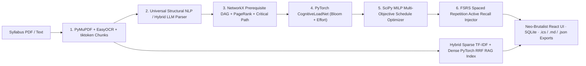

# SyllabAI — Neuro-Symbolic & Agentic AI Study Planner

An end-to-end **AI/ML Study Planner** that transforms any university or competitive-exam syllabus PDF (native text or scanned image PDFs) into a mathematically optimized, prerequisite-aware weekly & daily study roadmap.

Built with a **White & Chocolate Neo-Brutalist** React/TypeScript frontend and a **FastAPI + PyTorch + NetworkX + SciPy MILP** backend. Runs **100% locally with zero API keys required**, while optionally supporting **OpenAI**, **Google Gemini**, and **Local Ollama** structured LLM agents.

---

## Key Features

- **Multi-Modal PDF Ingestion & OCR Fallback**
  - Extracts layout-ordered text from native PDFs via **PyMuPDF**, with automatic **EasyOCR** bounding-box line reconstruction for scanned/image-only syllabi.
  - Supports Roman-numeral university syllabi (`UNIT I – V`), multi-line section headers (`Section 1:`), and raw pasted syllabus text, segmented into overlapping **tiktoken** chunks.
- **Prerequisite Knowledge Graph (`NetworkX` DAG)**
  - Infers prerequisite dependencies across modules using **TF-IDF cosine similarity** and domain concept rules, verifies strict DAG acyclicity, and computes **Critical Path** (`dag_longest_path`) and **PageRank centrality**.
- **PyTorch Cognitive Load & Bloom's Classifier (`CognitiveLoadNet`)**
  - Multi-task PyTorch MLP predicting **Bloom's Taxonomy** (`Remember` → `Create`) and **Cognitive Load (1–10)** + estimated study hours from 32-D pedagogical & hashed n-gram features.
- **SciPy MILP Multi-Objective Schedule Optimizer**
  - Solves a Mixed-Integer Linear Program (`scipy.optimize.milp`) assigning topics across weeks subject to **DAG topological ordering**, **weekly hour capacity budgets**, **exam-week buffers**, and **min-max load leveling**, with horizon-aware sub-module splitting so no week is left empty.
  - Includes an **Adaptive Re-Planner** to re-balance remaining weeks if you fall behind or change your weekly hours.
- **FSRS Spaced Repetition Engine**
  - Models exponential memory decay $R(t) = e^{-t/S}$, injects targeted **Active Recall** checkpoints, and dynamically updates memory stability $S$ from `Hard / Good / Easy` ratings.
- **Hybrid Sparse + Dense RAG Copilot ("Ask Your Syllabus")**
  - Combines **Sparse TF-IDF** and **Dense PyTorch subword embeddings** via **Reciprocal Rank Fusion (RRF)** for grounded Q&A with exact PDF page citations.
- **Exports & Focus Tools**
  - Built-in **Focus Pomodoro Timer** on every task card, **SQLite persistence**, and one-click exports to **`.ics` (Google/Apple/Outlook Calendar)**, **`.md` (Markdown Study Guide)**, and **`.json`**.

---

## System Architecture



---

## Tech Stack

| Layer | Technologies |
|---|---|
| **Backend & API** | Python 3.13, FastAPI, Uvicorn, Pydantic v2, SQLAlchemy 2.0 (SQLite) |
| **AI / ML & Optimization** | PyTorch, Scikit-Learn, SciPy (`milp`), NetworkX, NumPy, EasyOCR, PyMuPDF, `tiktoken` |
| **Optional LLM Adapters** | OpenAI (`gpt-4o-mini`), Google Gemini (`gemini-2.5-flash`), Local Ollama |
| **Frontend** | React 19, TypeScript, Vite 6, Tailwind CSS v4, Lucide Icons |
| **Testing** | Pytest, FastAPI `TestClient`, TypeScript (`tsc -b`) |

---

## Project Structure

```text
ATRISI/
├── backend/
│   ├── main.py                    # FastAPI app, lifespan, REST & export endpoints
│   ├── config.py                  # Environment & runtime settings
│   ├── database.py                # SQLAlchemy 2.0 SQLite persistence
│   ├── schemas.py                 # Pydantic v2 contracts
│   ├── ai/
│   │   ├── pdf_ingest.py          # PyMuPDF layout blocks + EasyOCR + tiktoken chunker
│   │   ├── syllabus_parser.py     # Universal unit/section parser + LLM JSON agent
│   │   ├── knowledge_graph.py     # NetworkX DAG, PageRank & Critical Path
│   │   ├── cognitive_model.py     # PyTorch CognitiveLoadNet (Bloom + load)
│   │   ├── optimizer.py           # SciPy MILP scheduler & task synthesizer
│   │   ├── spaced_repetition.py   # FSRS retention curve & active recall injector
│   │   ├── rag_engine.py          # Hybrid Sparse+Dense RRF retrieval & Q&A
│   │   ├── llm_providers.py       # OpenAI / Gemini / Ollama adapters with fallback
│   │   └── pipeline.py            # 6-stage orchestrator & Adaptive Re-Planner
│   ├── services/
│   │   ├── export_service.py      # RFC 5545 .ics, Markdown & JSON exporters
│   │   └── sample_syllabi.py      # 3 built-in sample university syllabus PDFs
│   └── tests/
│       ├── test_ai_modules.py     # Unit tests for all AI/ML modules
│       └── test_api_e2e.py        # FastAPI TestClient end-to-end tests
├── frontend/
│   ├── src/
│   │   ├── App.tsx                # Main dashboard & state orchestration
│   │   ├── api/client.ts          # Typed API client
│   │   ├── types/index.ts         # TypeScript interfaces
│   │   └── components/            # UploadWizard, WeeklyPlannerView, KnowledgeGraphView, AnalyticsView, SyllabusRagChat, etc.
│   └── package.json
├── requirements.txt
├── start.ps1                      # PowerShell launcher
├── run_app.bat                    # Windows 1-click launcher
└── .env.example
```

---

## Quick Start

### Prerequisites
- **Python 3.11+**
- **Node.js 20+** and **pnpm** (or `npm`)

### 1. Install Dependencies
```powershell
pip install -r requirements.txt
cd frontend
pnpm install
cd ..
```

### 2. Run the Application

**Option A — 1-Click Launcher (Windows):**
```powershell
.\run_app.bat
```
*(Or `.\start.ps1` in PowerShell.)*

**Option B — Two Terminals:**
```powershell
# Terminal 1: Backend API
python -m uvicorn backend.main:app --reload --port 8000

# Terminal 2: Frontend Dev Server
cd frontend
pnpm dev
```

Open **`http://localhost:5173`** in your browser. Interactive API docs are available at **`http://localhost:8000/docs`**.

*(Optional)* Copy `.env.example` to `.env` if you want to configure `OPENAI_API_KEY`, `GEMINI_API_KEY`, or `OLLAMA_BASE_URL`. No API key is needed for the default **Local Hybrid AI/ML** mode.

---

## Running Tests & Verification

```powershell
# Backend unit + end-to-end tests (11/11 passing)
pytest backend/tests -v

# Frontend TypeScript check & production build
cd frontend
pnpm build
```
